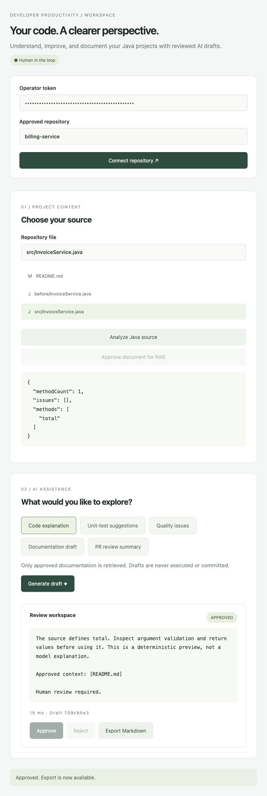

# DevAssist AI

An AI-assisted engineering workspace built with Java 21, Spring Boot, JavaParser, Python/FastAPI, React/TypeScript and PostgreSQL. Includes repository ingestion, Java analysis, explanations, test suggestions, quality findings, documentation drafts, snapshot-based PR reviews, approved-document retrieval, and mandatory human approval before export.



## Start with Docker

Prerequisites: Docker Engine with Compose v2. GitHub access and an LLM key are **not** required for demo mode.

```sh
cp .env.example .env
# Replace API_TOKEN, WORKER_TOKEN and DATABASE_PASSWORD with independent values:
openssl rand -hex 32
# Repeat three times and edit .env; do not commit it.
docker compose up --build -d
```

Open http://localhost:3000. Paste your API_TOKEN in the operator token field. The default repository is `billing-service`. Connect, analyze `src/InvoiceService.java`, select `README.md` and approve it for retrieval, then select the Java file again and generate a draft. Approve or reject it. Only approved drafts can be exported. The catalog example offers a second repository.

`demo` mode provides explicitly labeled deterministic previews, not real model reasoning. To use the real LLM adapter, set `LLM_MODE=live`, `LLM_MODEL` to a model available to your account, and `LLM_API_KEY` in `.env`, then recreate worker. The endpoint is fixed to OpenAI Chat Completions. Choose a compatible text model supporting `max_completion_tokens`. Source excerpts and retrieved documentation leave your machine in live mode after screening; only enable it for repositories approved for external processing. No tests or commands produced by a model are executed.

## Tests

```sh
mvn -B -f backend/pom.xml verify  # requires Java 21 + Maven
python3 -m venv .venv
. .venv/bin/activate
pip install -r worker/requirements.txt
(cd worker && pytest -q)
python evals/evaluate.py
(cd frontend && npm ci && npm test && npm run build)
# With Compose running, export the API_TOKEN from .env in your shell:
export API_TOKEN='<your configured token>'
python scripts/smoke.py
(cd frontend && npx playwright install chromium && npm run e2e)
```

[Verification results](docs/VERIFICATION.md) distinguish checks executed locally from pending Docker/GitHub checks. [Publication commands](docs/PUBLISH.md) create the requested separate repository.

## Local development

Run PostgreSQL and create a `devassist` database owned by `devassist`. Set `DATABASE_PASSWORD`, `API_TOKEN`, `WORKER_TOKEN` (at least 32 characters each for tokens). Use three terminals at repository root:

```sh
# Terminal 1; activate .venv first
(cd worker && uvicorn app:app --host 127.0.0.1 --port 8000 --no-access-log)
# Terminal 2
(cd backend && SERVER_PORT=18080 mvn spring-boot:run)
# Terminal 3; development proxy targets localhost:18080
(cd frontend && npm run dev -- --port 3000)
```

The Maven test suite uses H2 and a local HTTP worker fixture. For ephemeral development without PostgreSQL use `SPRING_DATASOURCE_URL='jdbc:h2:mem:demo;MODE=PostgreSQL;DATABASE_TO_LOWER=TRUE'` and `mvn spring-boot:run -Dspring-boot.run.useTestClasspath=true`. This is disposable storage, not a deployment substitute.

## Scope

This is a single-operator, self-hosted platform. The configured token grants access to all repositories explicitly mounted under `REPOS_ROOT`; there is no arbitrary cloning, URL ingestion or GitHub credential delegation. Mount a separate approved repository directory per deployment/trust domain. PR reviews compare explicitly supplied before/after files; they do not fetch GitHub PRs or post comments. Static quality analysis is heuristic and JavaParser-based. Retrieval uses local ranked lexical chunks, not external embeddings. Output remains a draft until reviewed.

- [Requirement coverage](docs/REQUIREMENTS.md)
- [Architecture and data flow](docs/ARCHITECTURE.md)
- [Security model and limitations](docs/SECURITY.md)
- [API reference](docs/API.md)
- [Evaluation methodology](docs/EVALUATION.md)
- [Deployment and operations](docs/OPERATIONS.md)

CI tests each component, evaluations, Docker builds, PostgreSQL smoke flows and a Playwright browser workflow. Tagged releases publish three images to GHCR only after CI succeeds for that commit. Deployment to an actual host is an operator action documented in operations.
