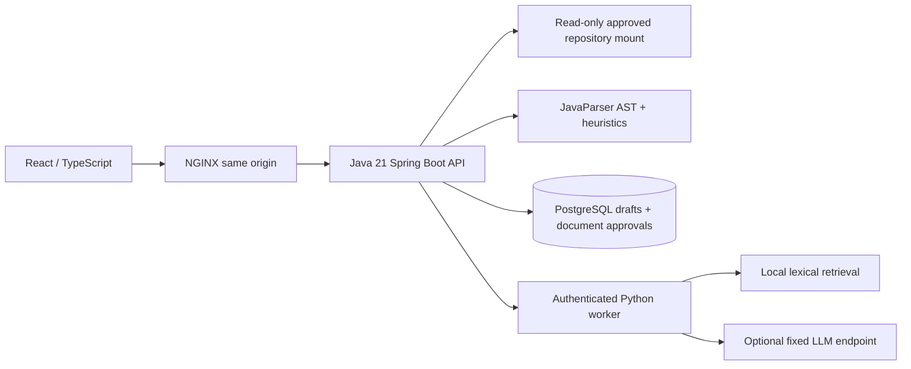

# Architecture

## Responsibilities

The browser holds an operator bearer credential in memory only. It displays output as plain text through React escaping; model Markdown is not rendered as HTML. NGINX sets CSP and a request-size limit. Backend authentication runs before API handlers. An authenticated principal has access only to the configured repository mount, which acts as the administrative allowlist. It cannot supply a remote repository URL, change the filesystem root, or choose a model endpoint.

The backend validates repository/file identifiers, rejects hidden path components, traversal and symlinks, bounds input, screens content and parses Java using JavaParser. The current AST rules flag long methods, parameter counts, console output and broad exception handlers. These rules are suggestions rather than a complete analyzer.

A document approval stores SHA-256 of the reviewed Markdown. Before each request the backend rereads and rescans approved documents and includes only matching snapshots. The worker chunks documents at 1,600 characters with 200-character overlap, ranks chunks by lexical overlap with source, and includes at most four. No embedding service sees the repository. File citations identify retrieved context; they do not prove model claims are true.

## Generation lifecycle

1. Operator chooses an allowlisted source path and one task.
2. Backend reads bounded source and optional before snapshot, screens it and computes AST metadata.
3. Backend loads at most 20 approved matching document snapshots in the same repository and operator scope.
4. Worker authenticates a separate credential and screens the complete request again.
5. In demo mode it creates a deterministic preview; in live mode it sends bounded evidence in a user message with a fixed system policy and no tools.
6. Both services screen generated output. Backend stores an immutable content draft as PENDING.
7. Operator reviews and atomically transitions PENDING to APPROVED or REJECTED. Export queries require APPROVED.

Drafts and approvals are persisted by PostgreSQL. File content is read from the mount, not uploaded into the database. Draft content can contain proprietary information and must be covered by backup/retention policy. This implementation keeps the last 100 drafts in listing, but does not delete older rows automatically.

Trace IDs are generated server-side, returned in `X-Trace-Id` and passed to the worker. JSON request logs record duration/status without source or credential bodies; worker logs generation duration, task, mode and context count. This is correlated request tracing, not OpenTelemetry span export.

## Deliberate constraints

One operator, one backend replica and bounded local ingestion keep access and rate enforcement understandable. For a shared enterprise deployment add OIDC identities, repository ACLs, independent reviewers if needed, centralized rate limiting, migrations, telemetry export, ingress TLS and externally managed secret scanning. JavaParser is configured for Java 21; preview syntax may require a future parser version. SQL initialization creates tables; it is not a schema migration system.
